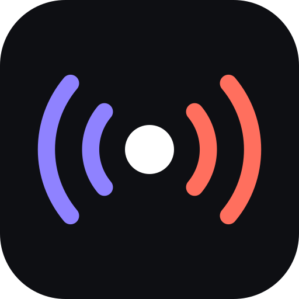

<p align="center">
  
</p>

# Simulcast Studio

Simulcast Studio is a free, open-source recording and livestreaming application for creators who want independent landscape and portrait productions in one application. Built on OBS Studio Rust, it combines familiar OBS workflows with native multistreaming, separate recordings and experimental Rust video filters.

**Project status: Alpha / active development.** Linux is our primary focus. Simulcast is an independent community fork, not an official OBS Project or OBS Rust product.

## Download

[](https://github.com/NotADeveloper4665/Simulcast-Studio/releases/tag/simulcast-alpha-build-9)
[](https://github.com/NotADeveloper4665/Simulcast-Studio/actions/runs/45865538881/artifacts/15139853973)

### Latest alpha — Build 9

Choose this channel for the established dual-canvas and multistream features. These are prereleases, not production-certified stable builds.

| Platform | Download |
| --- | --- |
| Fedora 44 x86-64 | [RPM](https://github.com/NotADeveloper4665/Simulcast-Studio/releases/download/simulcast-alpha-build-9/simulcast-studio-0.1.0-15.fc44.x86_64.rpm) |
| Fedora 44 x86-64 portable | [AppImage](https://github.com/NotADeveloper4665/Simulcast-Studio/releases/download/simulcast-alpha-build-9/Simulcast-Studio-Fedora44-x86_64.AppImage) |
| Ubuntu 26.04 amd64 | [DEB](https://github.com/NotADeveloper4665/Simulcast-Studio/releases/download/simulcast-alpha-build-9/Simulcast-Studio-Ubuntu26.04-amd64.deb) |
| Debian testing amd64 | [DEB](https://github.com/NotADeveloper4665/Simulcast-Studio/releases/download/simulcast-alpha-build-9/Simulcast-Studio-Debian-testing-amd64.deb) |
| macOS Apple Silicon | [DMG](https://github.com/NotADeveloper4665/Simulcast-Studio/releases/download/simulcast-alpha-build-9/Simulcast-Studio-macOS-arm64.dmg) |

[Release notes](https://github.com/NotADeveloper4665/Simulcast-Studio/releases/tag/simulcast-alpha-build-9) · [SHA-256 checksums](https://github.com/NotADeveloper4665/Simulcast-Studio/releases/download/simulcast-alpha-build-9/SHA256SUMS) · [All alpha releases (newest first)](https://github.com/NotADeveloper4665/Simulcast-Studio/releases)

Source: [`cb8b183`](https://github.com/NotADeveloper4665/Simulcast-Studio/commit/cb8b1833ae056740d2e5b8935e8a6627e5a0b307). The macOS package is experimental, ad-hoc signed and not notarized; browser and virtual camera are omitted. Debian 13 stable is not supported by this native build because it requires FFmpeg 8. The AppImage targets Fedora 44-compatible systems.

### Latest development — OBS plugin compatibility & AI background removal

[**Download the Fedora 44 development RPM (ZIP)**](https://github.com/NotADeveloper4665/Simulcast-Studio/actions/runs/45865538881/artifacts/15139853973)

Source: [`6ca9a8f`](https://github.com/NotADeveloper4665/Simulcast-Studio/commit/6ca9a8ff7397ad586cc4ea31539624c797388143). This is the latest successful development build as of November 26, 2026, including the GPU segmentation cadence optimizations. The full CI run passed, including RPM installation, stock OBS SDK plugin loading, Rust CPU inference and cadence tests.

- [Build details and artifacts](https://github.com/NotADeveloper4665/Simulcast-Studio/actions/runs/45865538881)
- [Development build history — check here for newer successful builds](https://github.com/NotADeveloper4665/Simulcast-Studio/actions/workflows/simulcast-plugin-compat.yml?query=branch%3Afeature%2Fobs-plugin-compatibility)
- [Development source branch](https://github.com/NotADeveloper4665/Simulcast-Studio/tree/feature/obs-plugin-compatibility)

GitHub Actions artifacts may require signing in and expire. Extract the ZIP before installation. This experimental channel currently provides only a Fedora 44 x86-64 RPM; the additional alpha platform packages do not include the new experimental features yet. The direct links above identify verified builds and will need updating when newer builds are published.

> [!WARNING]
> Back up important profiles and scene collections before switching channels. Both builds use the inherited OBS Rust configuration identity. A successful CI build is not proof of reliable live streaming, recording or every plugin on your hardware.

### Install on Fedora

Download the RPM (extract it first for the development channel), then open a terminal in its directory:

```bash
sudo dnf install ./simulcast-studio-*.fc44.x86_64.rpm
simulcast-studio
```

If switching to an older package, use the appropriate DNF downgrade operation rather than deleting your settings. For Linux source builds and setup, see [the build and dual-stream guide](docs/simulcast-studio.md).

## Which build has which features?

**Included** means the feature is packaged in the linked build, not that all hardware or runtime workflows have been verified. The development column refers to the successful compatibility RPM above.

| Feature | Alpha Build 9 | Development RPM |
| --- | :---: | :---: |
| Independent 16:9 and 9:16 canvases and previews | Included | Included |
| Multiple RTMP/RTMPS destinations, per-destination orientation, encoder and bitrate | Included | Included |
| Unified Start/Stop Streaming control | Included | Included |
| Dual horizontal/vertical recording | Included (Record Both) | Included (single recording control) |
| Separate output paths | Included | Included |
| Master audio volume controls | Included | Included |
| Independent vertical scene and source editing | Included | Included |
| Vertical transforms, cropping, visibility, lock and ordering | Included | Included |
| Vertical Studio Mode (independent Preview/Program, cut transition) | Included | Included |
| One Start/Stop Recording button with optional vertical output | — | Included |
| Source clones with independent filter chains | — | Included |
| Clean-source recording without other scene overlays | — | Included |
| Bundled Chromium browser source on Fedora | — | Included |
| Improved OBS plugin discovery and stock-SDK compatibility tests | — | Included |
| Native Rust GPU AI background removal and background blur | — | Included |
| Native Rust ONNX AI background removal | — | Included |
| Adjustable GPU segmentation rate and per-frame caching | — | Included |

Standard OBS source/filter APIs and much of the original plugin loading infrastructure are inherited in both channels. Compatibility with arbitrary third-party plugin binaries still depends on architecture, ABI and dependencies; the development tests are not a blanket compatibility guarantee.

## What Simulcast adds

### Streaming and canvas editing

- Create independent landscape and portrait layouts for platforms such as YouTube and other RTMP/RTMPS services.
- Configure multiple destinations in **Settings → Stream**, each with its own orientation, server, key, H.264 encoder and bitrate. The main streaming button controls the aggregate session when multistream is enabled.
- Edit vertical sources with independent scenes, source ordering, transforms, cropping, visibility and locks. Vertical Studio Mode separates Preview and Program with its own cut transition.
- Use the inherited OBS audio mixer together with the added master volume controls.

### Recording and source management

- Alpha builds use the **Record Both** control alongside normal recording. In the development build, a single **Start Recording** / **Stop Recording** control retains normal horizontal profile recording and adds an optional portrait MKV companion.
- Enable **Settings → Video → Enable vertical video recording** and configure its folder under Output. Recording pause is unavailable when dual recording is configured.
- **Clone Source (Independent Filters)** creates a filterable group around a reference to the original video source, avoiding a second capture device instance. Filters on the clone do not change the original; properties and filters on the underlying shared source still affect both.
- **Settings → Video → Clean Source Recording** records a selected input separately during streaming or recording, excluding other scene overlays. It uses an additional encoder, fixed starting dimensions and normal mix audio (not isolated gameplay audio). Filters already on that input remain in its clean recording.

### Browser source (development)

The existing [obs-rust/obs-browser](https://github.com/obs-rust/obs-browser) core module is enabled in the compatibility RPM with a bundled, pinned Chromium Embedded Framework (CEF) runtime. Add Browser from Sources for alerts, chat overlays, web pages and local HTML on either canvas. Browser rendering and custom docks still need platform-specific validation; Wayland browser docks have upstream limitations.

### New Rust filters (development)

Add these from a webcam's **Filters → Effect Filters** menu. They run locally and ship with the MediaPipe Selfie Segmentation landscape model. No model download is needed at runtime.

| Filter | Options |
| --- | --- |
| **AI Background Removal (GPU)** | Transparent background, optional background blur, blur strength and focus ratio; GPU shader inference without CPU readback |
| **AI Background Removal (Simulcast)** | ONNX Runtime segmentation, adjustable mask confidence and edge feathering; CPU inference path |
 
The GPU filter includes an adjustable segmentation update rate: Every frame, 30 FPS (default), 20 FPS and 15 FPS. Lower rates reduce inference work while keeping the webcam rendered at the normal frame rate; fast-moving edges may lag. Shader lookups and same-tick rendering are cached to avoid redundant processing. Hardware speedups and visual parity are not yet quantified.

Both filters are designed to draw nothing when inference cannot produce a usable mask rather than deliberately displaying the unfiltered image. Segmentation can still make mistakes; these filters are **not a privacy or security guarantee**.

The GPU shader implementation is adapted from [royshil/obs-backgroundremoval](https://github.com/royshil/obs-backgroundremoval) and its contributors, with the original licensing and model attribution retained. See the [GPU filter source and notices](https://github.com/NotADeveloper4665/Simulcast-Studio/tree/feature/obs-plugin-compatibility/plugins/simulcast-gpu-background-removal) and [ONNX filter documentation](https://github.com/NotADeveloper4665/Simulcast-Studio/tree/feature/obs-plugin-compatibility/plugins/rust-background-removal).

### Plugin compatibility (development)

The existing OBS C ABI remains the plugin interface, regardless of whether plugins are written in C, C++ or Rust. The development build improves plugin directory discovery and failure reporting and tests a filter compiled independently against the stock Fedora OBS SDK. It also tests registration of the bundled Rust filters.

Check **Tools → Plugin Manager** and application logs if a plugin fails. Consult the [compatibility guide](https://github.com/NotADeveloper4665/Simulcast-Studio/blob/feature/obs-plugin-compatibility/docs/obs-plugin-compatibility.md). A future optional Rust plugin SDK may draw on [rust-obs-plugins](https://github.com/bennetthardwick/rust-obs-plugins); that wrapper has not been adopted as a host compatibility layer.

## Project lineage

```text
Open Broadcaster Software (2012)
    └── OBS Studio — cross-platform rewrite (2014)
          └── OBS Studio Rust (obs-rust/obs-studio)
                └── Simulcast Studio
```

1. **[OBS Project / OBS Studio](https://github.com/obsproject/obs-studio)** — The original free, open-source broadcasting project began in 2012 and grew through the work of its creator and community contributors. OBS Studio followed as a cross-platform rewrite. It established the capture, scene composition, recording, encoding, streaming and extensible plugin foundations that Simulcast still relies on. Read the [OBS Project's own history](https://obsproject.com/blog/obs-progress-report-august-2018).
2. **[OBS Studio Rust](https://github.com/obs-rust/obs-studio)** — An independent fork and ongoing migration of OBS internals toward Rust, retaining a hybrid Rust/C/C++ application and the OBS plugin ecosystem. Simulcast inherits this work, including the existing engine, platform integrations, UI and plugin APIs. We do not claim authorship of that upstream work or that the entire application is Rust.
3. **[Simulcast Studio](https://github.com/NotADeveloper4665/Simulcast-Studio)** — A fork of OBS Studio Rust focused on simultaneous horizontal and vertical content production. The work specific to Simulcast is described above: integrated multistream controls, independent portrait editing and Studio Mode, dual and clean-source recording, independent source-clone filters, Fedora packaging and the experimental browser and AI filter integration.

Each project has its own maintainers and development goals. The original OBS Project and OBS Rust are separate projects and are not responsible for Simulcast-specific bugs.

## AI-assisted development disclaimer

**Simulcast Studio is an AI-assisted open-source project.** A substantial portion of the Simulcast-specific development, documentation and testing has been produced with the help of AI coding tools, under the direction of the project maintainer.

AI-generated code is welcome, but it is not automatically correct, secure, or reliable. Contributors should understand the changes they submit, review the code and verify its behavior. Generated tests and passing CI alone are not substitutes for real-world testing.

This is an early-stage experimental project, maintained independently. Expect bugs, incomplete features and hardware-specific differences. Do not rely on a development build for an important broadcast without testing it first. We welcome constructive bug reports, reproducible test results and contributions, whether human-written or AI-assisted.

## Roadmap

- Verify live multistreaming, recording, webcam filters and browser rendering across hardware.
- Expand tested third-party OBS plugin compatibility and installation tooling.
- Extend vertical Studio Mode beyond cuts and add full nested source-group editing.
- Evaluate optional shared encoders for compatible streaming destinations.
- Improve AI inference performance and isolated source audio recording.
- Bring validated experimental features to AppImage, DEB and macOS packages.

## Source, credits and license

Simulcast Studio retains upstream history, copyright notices, original licenses and dependency attribution. The host is distributed under [GPL-2.0-or-later](COPYING); individual components retain their applicable licenses, including GPL-3.0-or-later for the adapted GPU filter and Apache-2.0 for MediaPipe weights. See each component's notices.

- [Original OBS README](README.upstream.md)
- [Inherited OBS Rust README](README.obs-rust.md)
- [OBS Project](https://obsproject.com/) and [OBS Rust](https://github.com/obs-rust/obs-studio)

The primary branch is `master`. Clone it with its submodules:

```bash
git clone --branch master --recurse-submodules https://github.com/NotADeveloper4665/Simulcast-Studio.git
cd Simulcast-Studio
```

Successful Fedora builds on master publish numbered alpha prereleases; additional platform assets follow their individual build checks. Experimental compatibility development is isolated on its own branch.

Report Simulcast-specific issues [here](https://github.com/NotADeveloper4665/Simulcast-Studio/issues). Include your build commit, operating system, GPU, logs and steps to reproduce the problem.
